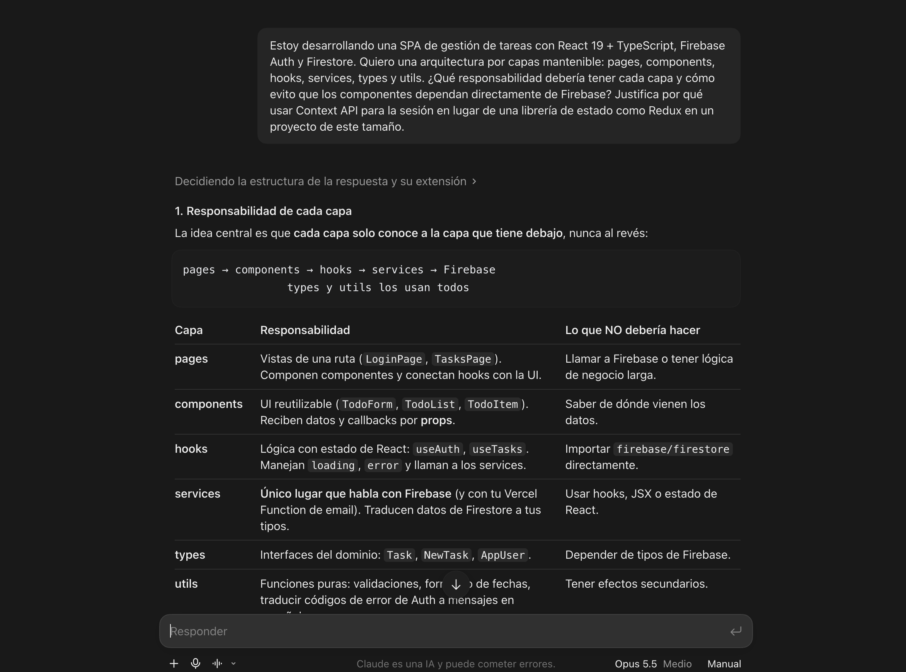
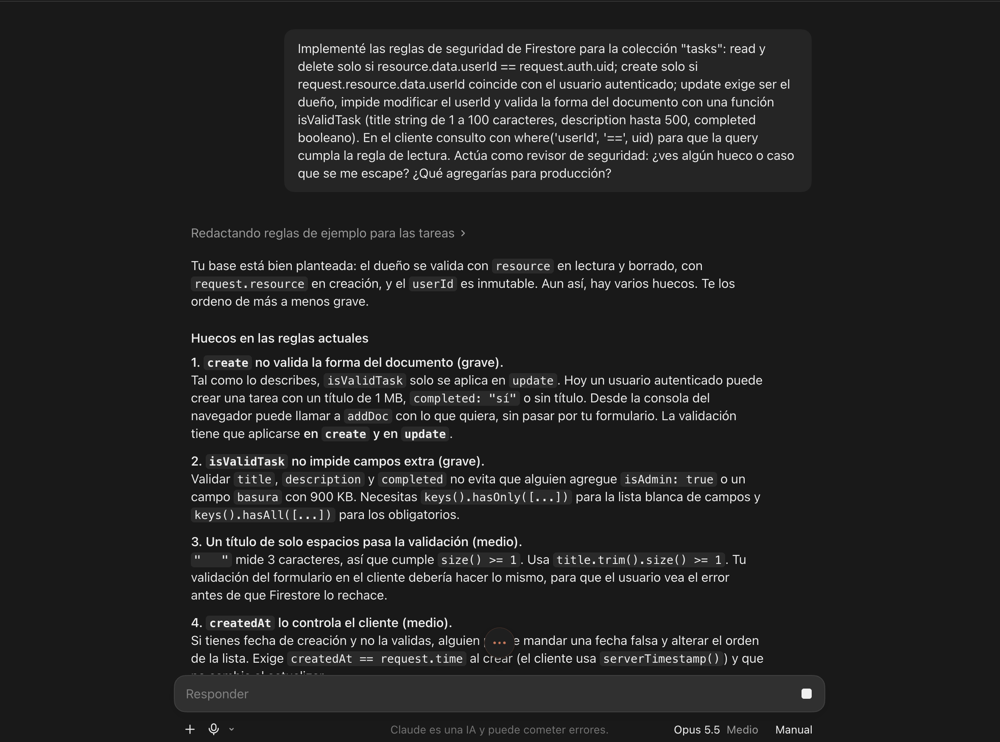
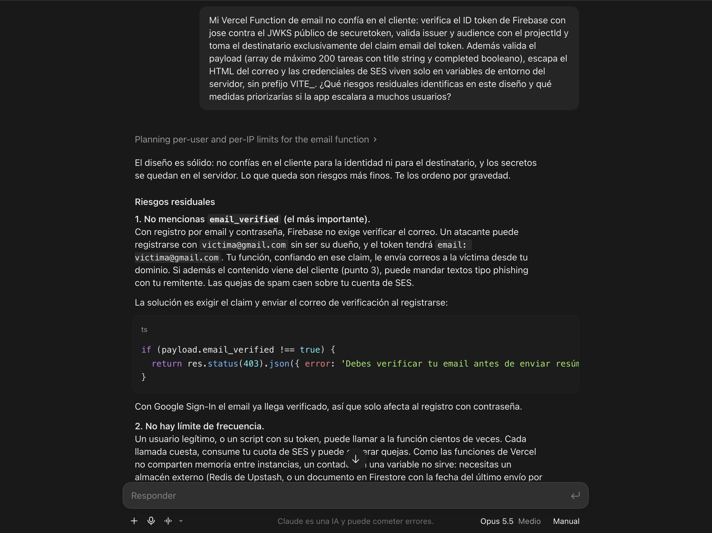
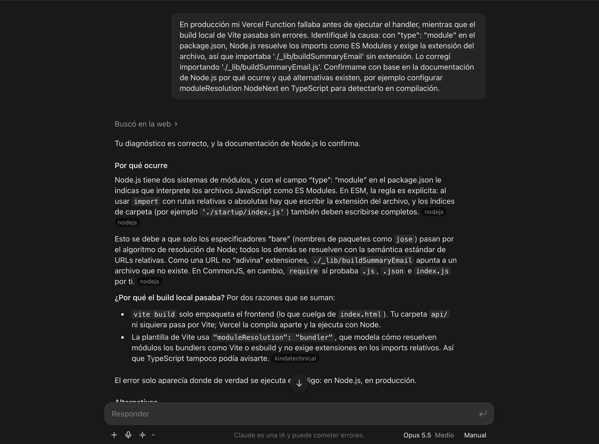
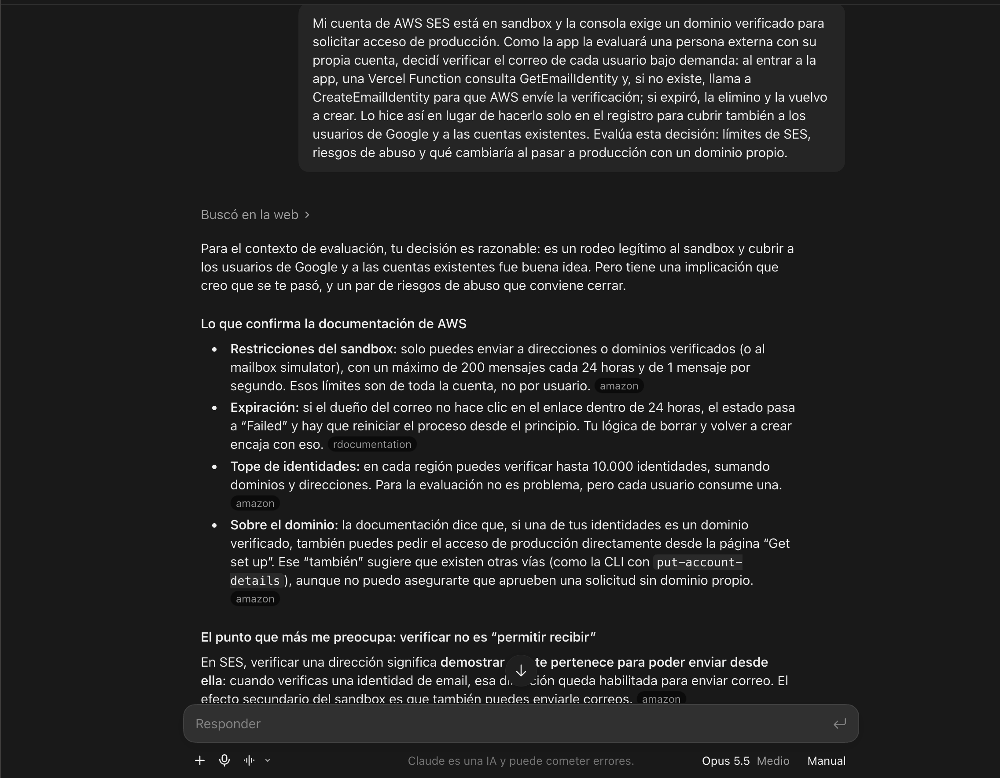
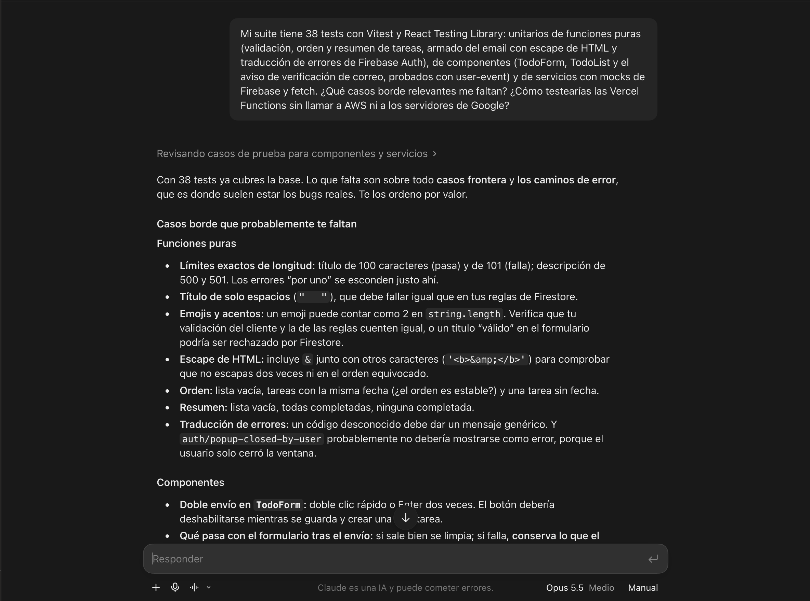

# Documentación del uso de inteligencia artificial

## Apoyo durante el desarrollo

El Gestor de Tareas se desarrolló con apoyo de **Claude** (Anthropic) como herramienta de aprendizaje y colaboración. Se utilizó para planear el proyecto a partir de la consigna, explicar conceptos (Firebase, Firestore, Vercel Functions, AWS SES, testing), proponer la arquitectura, generar código comentado, diagnosticar errores y revisar el avance contra la rúbrica.

La colaboración fue iterativa y paso a paso. Sebastián definió el alcance, las prioridades y el orden de trabajo; configuró los servicios externos en sus consolas (Firebase, AWS SES e IAM, Vercel); decidió el diseño visual y propuso cambios de experiencia de usuario, como el enlace para volver al inicio de sesión, el footer y el flujo de verificación del correo al registrarse. Claude convirtió esas decisiones en propuestas de código con comentarios, que Sebastián revisó, cuestionó cuando no le convencían y validó antes de cada commit.

## Cómo se validó el código generado

Ningún cambio se dio por bueno solo porque lo propuso la IA:

- **Compilación:** `npm run build` (chequeo de tipos con TypeScript) antes de cada commit.
- **Tests automatizados:** `npm test` con Vitest y React Testing Library.
- **Pruebas manuales:** cada funcionalidad se probó en local y en producción (registro, login con Google, CRUD, reglas de seguridad con dos cuentas distintas, envío de email).
- **Revisión de seguridad:** `git status` antes del primer commit para confirmar que `.env` no se subiera, y verificación de que las credenciales de AWS solo existieran en Vercel.
- **Comparación con la consigna y la rúbrica** para confirmar que cada requisito estuviera cubierto.

## Patrones de uso y aprendizajes

- **Pedir pasos pequeños y verificables.** Avanzar un paso a la vez (crear, probar, hacer commit) hizo que los errores fueran fáciles de ubicar.
- **Dar contexto completo.** Compartir la consigna, el estado actual y capturas de pantalla produjo respuestas mucho más precisas, sobre todo cuando las consolas de Firebase, AWS o Vercel no coincidían con lo esperado.
- **Pedir el porqué, no solo el código.** Solicitar comentarios en el código y la justificación de cada decisión ayudó a entenderlo y a poder explicarlo.
- **Pedir revisión crítica de lo implementado.** En lugar de preguntar solo "¿cómo hago X?", se explicaba la solución ya aplicada y se pedía a la IA actuar como revisora: buscar huecos de seguridad, casos borde y alternativas.
- **Cuestionar y comparar alternativas.** Por ejemplo, ante el sandbox de AWS SES se compararon varias opciones antes de decidir el flujo de verificación del correo.
- **Validar siempre con pruebas reales.** La IA también se equivoca o se desactualiza (por ejemplo, con interfaces de consolas que cambiaron), por lo que todo se comprobó con build, tests y pruebas en producción.
- **No compartir secretos.** Las claves de AWS se configuraron directamente en `.env` y en Vercel; nunca se enviaron a la IA ni aparecen en capturas.

## Decisiones técnicas apoyadas por la IA

| Decisión | Motivo |
|---|---|
| Arquitectura por capas (services → hooks → componentes) | Los componentes no dependen de Firebase; cambiar de proveedor solo afecta a los servicios. |
| Context API para la sesión | Suficiente para compartir el usuario; evita una librería de estado extra en un proyecto de este tamaño. |
| `onSnapshot` para las tareas | La interfaz se actualiza sola tras cada operación, sin volver a pedir los datos. |
| Reglas de Firestore en el servidor | El filtro por `userId` en el frontend no protege los datos por sí solo. |
| Verificación del ID token en la Vercel Function | El servidor no confía en el navegador; el correo de destino sale del token verificado. |
| Variables de AWS sin prefijo `VITE_` | Vite solo expone al navegador las variables con ese prefijo. |
| Verificación del correo bajo demanda | Permite usar el email en el sandbox de SES con cualquier cuenta, incluidas las de Google. |

## Ejemplos de consultas de apoyo

Estas capturas documentan consultas sobre decisiones técnicas del proyecto y las respuestas recibidas. En la mayoría se describe la solución implementada y se solicita una revisión crítica o una confirmación con base en la documentación.

### 1. Arquitectura por capas

Consulta sobre la responsabilidad de cada capa y por qué usar Context API para la sesión.

### 2. Revisión de las reglas de Firestore

Solicitud de revisión crítica de las reglas de seguridad implementadas, en busca de huecos y mejoras para producción.

**Resultado:** la IA señaló cuatro posibles huecos. Al contrastarlos con el código, el primero (falta de validación en `create`) no aplicaba: las reglas ya validaban la tarea al crearla, solo que el prompt no lo mencionaba. Los otros tres sí eran mejoras válidas y se aplicaron en `firestore.rules`:

- Lista blanca de campos con `keys().hasOnly([...])` y `keys().hasAll([...])`, para impedir campos extra.
- `title.trim().size() > 0`, para rechazar títulos de solo espacios también en el servidor.
- `createdAt` y `updatedAt` deben ser la hora del servidor (`request.time`), y `createdAt` no puede cambiar al editar.

### 3. Revisión de seguridad del endpoint de email

Evaluación de los riesgos residuales del diseño de la Vercel Function (verificación del token, validación del payload y manejo de credenciales).

**Resultado:** la IA confirmó que el diseño es sólido y señaló dos riesgos residuales, que se analizaron frente al contexto real del proyecto:

- **`email_verified` no se exige.** Con registro por correo y contraseña, alguien podría registrarse con un correo ajeno. En este proyecto el riesgo está mitigado por el sandbox de SES: ningún resumen llega a una dirección hasta que su dueño confirma el correo de verificación de AWS. Exigir `email_verified` ahora bloquearía a los usuarios registrados con contraseña, porque requeriría además el flujo de verificación de Firebase (un segundo correo). Queda como mejora necesaria al salir del sandbox.
- **No hay límite de frecuencia.** Hoy el sandbox impone 200 correos al día y 1 por segundo. Si la app escalara, se agregaría un límite por usuario guardado en un almacén compartido (por ejemplo, la fecha del último envío en Firestore), ya que las funciones serverless no comparten memoria entre instancias.

### 4. Diagnóstico del error en producción

Confirmación, con base en la documentación de Node.js, de la causa identificada (imports sin extensión en modo ES Modules) y de alternativas para detectarla en compilación.

**Resultado:** la IA confirmó el diagnóstico citando la documentación de Node.js: en ES Modules los imports relativos se resuelven como URLs y no se "adivinan" extensiones (a diferencia de `require` en CommonJS). El build local no lo detectaba porque `vite build` solo empaqueta el frontend (la carpeta `api/` la compila Vercel aparte) y la plantilla usa `"moduleResolution": "bundler"`, que no exige extensiones. Se mantuvo la corrección con `.js`, documentada con un comentario en el código.

### 5. Decisión ante el sandbox de AWS SES

Evaluación de la decisión de verificar el correo de cada usuario bajo demanda: límites, riesgos y cambios al pasar a producción.

**Resultado:** la IA consideró la decisión razonable para el contexto de evaluación y confirmó con la documentación de AWS los límites del sandbox (200 correos cada 24 horas, 1 por segundo y hasta 10.000 identidades por región) y que la verificación expira a las 24 horas, lo que coincide con la lógica de borrar y volver a crear la identidad. También señaló una implicación importante: en SES, verificar una dirección la habilita como **remitente**, no solo como destinatario. En este proyecto eso está acotado porque el remitente es siempre fijo (`SES_FROM_EMAIL`) y las credenciales solo existen en el servidor. Como mejora de mínimo privilegio, la política IAM podría restringir `ses:SendEmail` a ese remitente con la condición `ses:FromAddress`. Al pasar a producción con un dominio propio, el flujo de verificación por usuario dejaría de ser necesario y esas identidades se eliminarían.

### 6. Revisión de la cobertura de tests

Revisión de la suite de tests existente para identificar casos borde faltantes y cómo probar las Vercel Functions sin servicios externos.

**Resultado:** al contrastar las sugerencias con la suite, varias ya estaban cubiertas (título de solo espacios, código de error desconocido, resumen vacío, tarea sin fecha y conservar el formulario si falla el guardado). Se agregaron las que faltaban:

- Límites exactos de longitud (100 y 500 caracteres aceptados).
- Escape de `&` sin doble escape en el HTML del email.
- Prevención del doble envío en `TodoForm` mientras se guarda.
- **Tests de la Vercel Function `/api/send-summary`** con la verificación del token y el cliente de SES simulados: sin token (401), token inválido (401), payload inválido (400), envío al correo del token aunque el cliente intente indicar otro destinatario (200) y rechazo de SES por correo no verificado (403).

